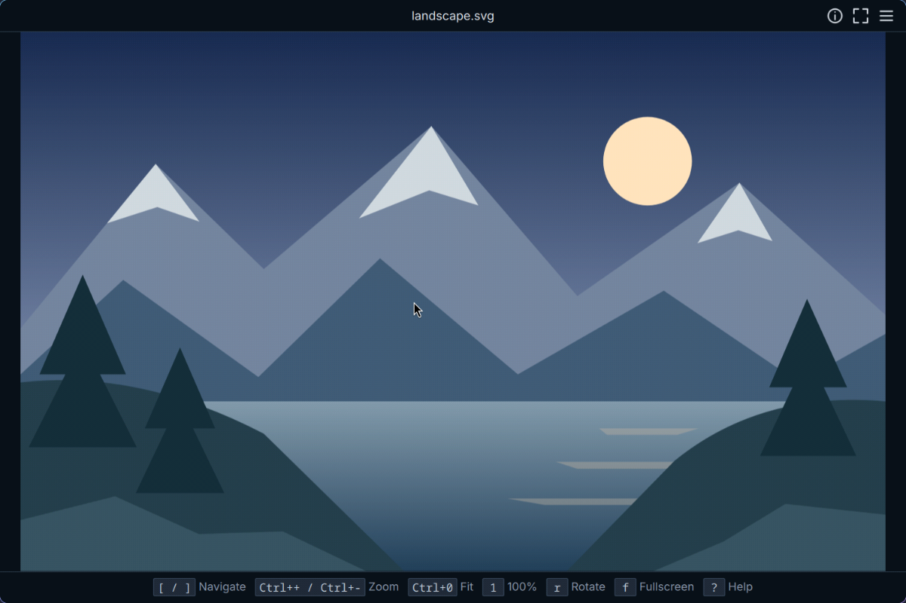

# HoloNight Viewer

For current build, test, container acceptance and provider workflows, see [DEVELOPMENT.md](DEVELOPMENT.md).

A standalone, keyboard-first image viewer for native Wayland, built on the
HoloNight theme and controls ([holonight-config](https://github.com/lebedenko/holonight-config),
[holonight-qt](https://github.com/lebedenko/holonight-qt)), with
[holonight-images](https://github.com/lebedenko/holonight-images) and
[holonight-thumbnails](https://github.com/lebedenko/holonight-thumbnails). X11 and XWayland are
outside the supported scope.

Open one local image, inspect it with fit, actual size, zoom, pan and temporary
transforms, then browse the supported images in its folder. Images decode in the
background, honor embedded orientation, and fit the window. Original files are
opened read-only and never changed.



- Open local images through the portal, file drops or `hn-viewer`.
- Browse folders in natural order or use a thumbnail grid.
- Inspect PNG, JPEG, BMP, WebP, TIFF and crisp vector SVG.
- Play and pause animated GIFs.
- Zoom, pan, rotate and flip without changing originals.
- Inspect image information and copy images or paths.

See [Unreleased notes](docs/releases/unreleased.md) for the current source contract.

Viewer implementation is split into non-installed `viewer-images`, `viewer-browsing`,
`viewer-thumbnails` and `viewer-platform` targets under `apps/viewer`. QML controllers,
presentation formatting, canvas and geometry remain executable-owned. Each private
target exports its own headers and keeps implementation dependencies private.

## Requirements

- **Build:** C++23, Qt 6.11+ (including Qt DBus and the Qt GUI private module),
  CMake 3.25+, Ninja, Task, tomlplusplus, pkg-config, libwebp, libexif,
  wayland-client, wayland-protocols, wayland-scanner, and installed
  HoloNightConfig, HolonightQt::Core / HolonightQt::Controls,
  HolonightImages and HolonightThumbnails.
- **Tests:** Qt Test, GTest and `dbus-run-session`.
- **Checks:** clang-format, clang-tidy (run-clang-tidy), REUSE, desktop-file-utils,
  GIO, AppStream (`appstreamcli`) and Python 3.
- **Codecs:** Qt Base's PNG/BMP support and JPEG/GIF plugins, plus Qt Image
  Formats' WebP and TIFF plugins (Arch: `qt6-base qt6-imageformats`), plus Qt's own `Qt6::Svg`
  module for vector SVG rendering (not a `QImageReader` plugin). See
  [Supported formats](#supported-formats-and-limits).

Use the shared image described in [DEVELOPMENT.md](DEVELOPMENT.md) for the exact acceptance environment.

## Quick start

Install the dependencies described in [DEVELOPMENT.md](DEVELOPMENT.md), then run:

```sh
task build
task test
task run -- /path/to/image.png
task check
```

## Usage

### Opening images

Open one local image with **Open…**, **Ctrl+O**, a file drop, or a command-line path.
Open… and Ctrl+O use the desktop's xdg-desktop-portal file picker, attached to the
Viewer window. Viewer calls the portal FileChooser itself, so Open does not depend on
the platform theme; Qt's built-in dialog appears only when no portal can serve the
request. Escape, closing the picker, or its Cancel button cancels and restores the
previously focused control if it is still available; the current view is preserved.

On the command line, pass one local path (quote spaces) or a local file URL, and use
`--` before filenames beginning with a dash. Remote URLs and multiple files are
rejected. Existing local paths are resolved before URL parsing, so `frame:1.png`
opens when present; a missing `frame:1.png` is rejected as a URL, while
`./frame:1.png` reports the normal missing-file error. `--help` and `--version` are
supported.

See [DEVELOPMENT.md](DEVELOPMENT.md) for current native and container commands.

Missing, corrupt and unreadable images produce a recoverable error in the window,
reported once per attempt (each retry or refresh reports again); Open remains
available. With no image open, the canvas shows a subtle, theme-tinted Viewer icon
with "No image open" and "Ctrl+O to open · or drop an image here". The icon shrinks,
then hides, on short windows while the text keeps its size, and it disappears once
an image opens, including a transparent one.

### Keyboard and mouse

| Control | Action |
| --- | --- |
| `[` / Previous, `]` / Next (aliases: `h` / `l` in single view) | Browse siblings, stopping at folder boundaries |
| `Ctrl+o` / Open… | Choose an image with the desktop file picker |
| `Ctrl+r` / Refresh | Rescan the folder and reload the selected image, clearing the cache; an animated GIF restarts from its first frame |
| `Ctrl+g` / Grid View | Toggle the thumbnail grid (see [Grid view](#grid-view)) |
| `Space` | Play or pause an animated GIF (ignored for still images and while a header button has focus) |
| `Ctrl+0` (alias: `0`) / Fit | Center the whole image and fit it as the window changes |
| `1` / Actual Size | Center at one source pixel per physical display pixel |
| `Ctrl++` / `Ctrl+-` (aliases: `Ctrl+=`, `+` / `-`) | Zoom in/out around the canvas center |
| Vertical wheel or trackpad scroll over the canvas | Zoom around the pointer |
| Left-button drag | Pan the image |
| Arrow keys | Pan the viewed region from anywhere in the window |
| `r` / `Shift+r` | Rotate clockwise / counterclockwise by 90° |
| `x` / `Shift+x` | Flip horizontally / vertically relative to the displayed image |
| Menu → Reset Transform | Clear temporary rotation and flips |
| `Ctrl+c` | Copy the entire transformed image, including transparency |
| `Ctrl+Shift+c` | Copy the normalized absolute path, unquoted; retain symlink paths |
| `i` | Open or close the Image Information card |
| `?` | Open or close the Shortcut Help card |
| `f` / Fullscreen | Toggle fullscreen; `Escape` leaves it (in grid view `Escape` closes the grid first) |
| `q` / Quit | Quit Viewer |

Mouse Back/Forward buttons trigger previous/next once per click, browsing images in single view and moving selection in grid view.

`gg` requires two unmodified `g` presses within one second. Auto-repeat is ignored; another key, mouse input, focus loss, or a grid/menu/modal change cancels the sequence. Letter keys are shown in lowercase in hints; Help labels aliases explicitly.

Viewer shortcuts pause while Open, Image Information or Shortcut Help is active.
Escape closes a card or dialog before leaving fullscreen; closing clears the focus
ring. Fullscreen restores the previous normal/maximized state, including
compositor-managed tiling. Native decorations belong to Qt and the compositor. The toolbar shows a left-aligned image or folder heading in windowed and fullscreen modes while visible. Native titles identify the current image or folder (and the completed image count).

Tab and Shift+Tab cycle through the enabled header buttons (Information, Fullscreen,
Menu, Close); the empty window skips Information. Image actions clear the focus ring. In the
menu, j/k and Down/Up move between items, skipping separators; single-key shortcuts
still act while the menu is open and close it. The menu groups Open/Refresh/Grid View,
Previous/Next, view controls, transforms, copying, Image Information/Shortcut Help and
Fullscreen/Quit, with each item's shortcut shown right-aligned.

### Header preferences

The heading and far-right Close button are independently optional and visible by
default in windowed and fullscreen modes. Close uses the normal Quit action and
window shutdown lifecycle. Native window titles and decorations are independent.
The empty heading is “HoloNight Viewer”; long headings use middle elision.

Viewer reads `$XDG_CONFIG_HOME/holonight-viewer/config.toml`, falling back to
`$HOME/.config/holonight-viewer/config.toml` when XDG_CONFIG_HOME is unset or empty:

```toml
[header]
show_title = true
show_close_button = true
```

Defaults are merged per key with the base file, then the first existing
`config-<desktop>.toml` for the launch-time `XDG_CURRENT_DESKTOP`. Colon-separated
names are tried in order, ignoring empty entries and lowercasing ASCII letters.
Only ASCII letters, digits, hyphens and underscores are accepted. For
`HoloNight-Hyprland:HoloNight:Hyprland`, priority is `config-holonight-hyprland.toml`,
`config-holonight.toml`, then `config-hyprland.toml`. Only one override contributes.

Changes reload automatically after a 100 ms debounce, including atomic saves,
creation, deletion and directory recreation; override selection is repeated using
the launch identity. Missing keys inherit individually. Invalid names, unknown
keys, invalid types and unreadable or malformed files produce warnings. Invalid
values are ignored; unreadable or malformed files are ignored entirely. An invalid
selected override never falls through to a later candidate. Reload starts from
defaults, so invalid values inherit valid lower layers rather than stale values.
Viewer never creates or writes configuration files. Hiding a focused Close moves
focus to Menu; reload leaves menu and modal focus alone. Fullscreen toolbar
auto-hide still applies to both preferences.

### Zoom, pan and transforms

100% means physical pixels, even at fractional display scaling. Zoom normally ranges
from 1% to 3200%, extending to include Fit for unusually small or large images.
Manual zoom is preserved across resize, fullscreen and display-scale changes.
Panning stops at image edges and centers axes that fit. Opening another image resets
to Fit.

Transforms compose in invocation order and reset zoom/pan to Fit. Open, navigation
and Ctrl+R clear them; returning to a file does not restore them.

### Overlays

The header shows the left-aligned filename and equally sized, theme-tinted glyphs.
Close uses the theme’s error background and contrasting foreground on hover. The
shortcut footer stays on one line below the canvas; as the window narrows, hints
hide from the right while the Help shortcut remains visible. In fullscreen, the
canvas fills the window and the header and footer overlay it. They appear with
the navigation controls on entry or mouse movement, then hide together after
three seconds. Hovering a control or either bar holds them; an open menu keeps
the header visible. Keyboard focus reveals the header and keeps it visible while
any header control has focus.

- **Navigation arrows** appear on mouse movement for three seconds (held while the
  pointer rests on an arrow). Keyboard input hides them immediately; in fullscreen
  it also hides the footer and, unless a header control has focus, the header,
  without resetting the countdown.
- **Details strip** appears for four seconds after a new or refreshed image first
  renders and after zoom, Fit, Actual Size, rotate, flip or mouse movement; resizing
  does not reveal it. It shows transformed dimensions, decimal file size,
  physical-pixel scale (including Fit) and folder position, wrapping at narrow widths
  without resizing the canvas. An animated GIF adds `Animated`, `Playing` or `Paused`,
  and its frame count (`N frames`, omitted while unknown). If a frame cannot be decoded,
  playback stops on the last good frame and the strip shows a "Playback stopped:
  damaged frame" notice until you leave the file.
- **Play/Pause button** sits at the center of the canvas for an animated GIF and fades
  with the navigation arrows; its glyph and name show the action it performs.

Both fade in and out.

### Animated GIF

A GIF with more than one frame plays automatically from its first frame, honouring
each frame's delay (delays of 10 ms or less play as 100 ms, as browsers do) and its
loop count, then stops on the final frame when it does not loop; `Space` or the
button replays it. Pausing keeps the time left on the current frame. Zoom, pan and
transforms carry on during playback and never restart it. Playback pauses while
Open, Image Information or Shortcut Help is active and while the window is hidden or
minimized, and resumes afterwards unless you paused it yourself; losing focus alone
does not pause. Copy takes the frame on screen. A single-frame GIF behaves as a still
image. Frame compositing (transparency, disposal) is Qt's GIF handler's.

### Image Information and Shortcut Help

**Image Information** (`I`) is a card over a lightly dimmed image. Its fixed header
shows a preview (hidden below 360 px wide), the filename, a
`format · W × H · MP · size` summary, a "Rotated view W × H" line while a quarter turn
swaps the dimensions, and the locale's short modification date and time. Below it
scroll these sections:

- **CAMERA:** camera; lens, focal length and aperture; shutter and ISO
- **LOCATION:** coordinates and altitude
- **FILE:** the path with the home directory shown as `~`, selectable and copyable

Missing facts and empty sections are omitted, and "Details unavailable" replaces an
empty summary. EXIF is read from JPEG, PNG, WebP and TIFF files (TIFF up to 64 MiB) with libexif;
damaged metadata is omitted. Facts follow cached image snapshots and the open card follows
document changes; after closing it, `Ctrl+R` also refreshes the cached facts.

**Shortcut Help** (`?`) is a matching card with a fixed "Shortcuts" header and
scrolling NAVIGATION, VIEW, TRANSFORM, IMAGE, APPLICATION and MOUSE sections. Long
key hints wrap within their column at larger text sizes.

Close either card with its key, Escape, its × button or a click outside.

### Folder browsing

Opening starts a nonrecursive folder scan without delaying the image; the position
indicator shows scanning feedback until it finishes. Supported suffixes follow
installed Qt handlers, case-insensitively. Hidden siblings are excluded, but the
explicitly opened file stays included even if hidden, extensionless or missing.
Filenames use natural order (`image2` before `image10`), case-insensitive text and
original-name tie breaking. Symlink paths retain the folder you opened.

Navigation remains available while decoding or showing an image error. Broken files
keep their positions, and Ctrl+R retains a deleted selection so you can navigate
away. Folder-read failures appear separately and preserve single-image viewing.
There is no live watcher: press Ctrl+R after additions, renames or external edits.

### Grid view

`Ctrl+G` (or Menu → Grid View, which shows a check mark while the grid is open) replaces
the canvas with a grid of thumbnails of every image in the folder, in the same order as
browsing. It needs an open image with a non-empty folder and toggles back the same way;
the header then reads "folder — N images". The open image is selected and scrolled
into view when the grid opens.

| Key | In grid view |
| --- | --- |
| `h` `j` `k` `l` or the arrow keys | Move the selection; left/right flow across rows without wrapping, up/down move a row and clamp to the last item |
| `gg` / `Shift+g` | Select and reveal the first / last item without opening it |
| `Ctrl+U` / `Ctrl+D` | Move half the visible rows up / down |
| `[` / `]` and Menu → Previous / Next | Move the selection by one (the open image does not change) |
| `Enter`, double-click | Open the selected image in single view |
| Click | Select a cell |
| `Escape` or `Ctrl+G` | Close the grid and return to the image that was open before it, whatever the selection; in fullscreen the first `Escape` closes only the grid |

`Ctrl+O`, dropping a file and `Ctrl+R` still work; a file opened either way shows in
single view, and a cancelled dialog leaves the grid. Zoom, fit, 1:1, rotate/flip,
playback, pan, copy image and Image Information are unavailable in grid view. A focused
header button keeps `Enter` and `Space`, so Tab to a button then Enter/Space activates it;
any grid key moves focus back to the grid.

Thumbnails fit a 256 × 256 logical-pixel box without enlarging small images (SVGs scale
up), decode at the display's scale factor, apply EXIF orientation and show the first
frame of animated images. They decode on a worker pool of about half the CPU threads,
only for the visible cells plus roughly one page; requests for cells that scroll away
are dropped. A bounded cache (1000 thumbnails, 256 MiB) is used, and `Ctrl+R` decodes
again. A cell shows a placeholder while loading and a broken-image glyph when the file
cannot be decoded or exceeds the image limits; it stays selectable and still opens in
single view. An SVG that links external local images shows the glyph in the grid.
During a scan the grid shows a busy state, and a rescan keeps the selection on the same
file, or on the same position when that file is gone.

### Copying

**Copy Image** captures the image and orientation when invoked, ignoring zoom and pan,
and publishes it as `image/png`. SVG copying rasterizes at intrinsic dimensions,
rounded to positive pixels and proportionally reduced when needed to meet the
decoded-image limits. Transparency and orientation are preserved. Self-contained
SVG bytes are captured at invocation; linked local resources are read by the worker
during preparation. Copy failure preserves the previous clipboard.
**Copy Path** copies the absolute path and remains
available during loading and errors. Both commands pause while a copy is being
prepared; browsing and inspection remain available. Feedback names the copied file,
so it is distinguishable from a later selection. A failed copy leaves the clipboard
untouched.

Only the standard clipboard is used; the primary selection is untouched. Clipboard
persistence after exit is managed by the desktop.

## Supported formats and limits

The guaranteed formats are static **PNG, JPEG, BMP, WebP, TIFF and SVG**, and **GIF**
(GIF87a and GIF89a, including animation). TIFF is guaranteed for single-page, 8-bit,
uncompressed RGB, RGBA, grayscale and palette files; a multi-page TIFF shows its
first page only. Other TIFF variants (16-bit, float, CMYK, Lab, tiled, BigTIFF and
compressed files) and other installed Qt image handlers work on a best-effort basis:
they either open or show an error, and some valid files, such as tiled TIFF, may not
open. Other animated files (APNG, animated WebP) show their first frame only. Missing
codecs, including the Qt GIF and TIFF plugins, fail qualification, not ordinary
startup.

SVG renders as true vector graphics, staying crisp at any zoom level instead of being
decoded to a fixed-resolution raster; it is not subject to the pixel/decoded-image
limits below or the decode cache, and it carries no EXIF. SVG files are capped at
10 MiB, checked against both reported size and actual bytes by HoloNight Images. Self-contained SVGs
load retained bytes into the GUI renderer; documents with local linked images retain filename-relative loading.
Other resource-policy violations report an unsupported-resource error. Layout, information and bounded previews
prefer the document's default size over its viewBox; vector layout retains fractional dimensions.
See [shared SVG support](docs/sdd/shared-svg-support/SPEC.md). `.svgz` (gzip-compressed) and animated
(SMIL/CSS) SVG are not supported — only the static markup renders.

Qt is the primary decoder. A private libwebp fallback handles simple static RIFF
VP8/VP8L files that Qt cannot inspect or decode, including the compact Qt 6.11.2
regression; extended containers, metadata and animation stay on the Qt path.
Installed runtimes need libwebp, libexif and the Qt plugins.

| Limit | Value |
| --- | --- |
| Encoded input | 256 MiB |
| Decoded pixels | 64 million, and 32,768 on either axis |
| Decoded image | 256 MiB |
| Displayed image plus decode cache | 512 MiB |

Every frame of a GIF is checked against the same decoded-pixel and decoded-image
limits as a still image. While a GIF plays, the displayed frame and one look-ahead
frame count toward the 512 MiB, and the decode cache gets what remains, so the
frame count never changes memory use.

Oversized images and unsupported dimensions produce an error instead of a
lower-resolution substitute. See [Design notes](#design-notes) for what these bounds
exclude.

## Installation

Version **0.1.0** is a source release with CMake installation; no distribution
packages, portable binaries or bundled providers are supplied. The
[historical release notes](docs/releases/v0.1.0.md) list the providers tested for
that tag. Those records do not qualify current source; current changes are documented
in [Unreleased notes](docs/releases/unreleased.md).

### Installation and ownership

Coordinated system installation and removal belong to the HoloNight umbrella.
Viewer's Task workflow only stages files; it never invokes sudo:

```sh
task stage DESTDIR=/your/stage
```

For standalone installation, configure explicitly against compatible installed
providers (the revisions in CI), build and inspect a stage first:

```sh
cmake -S . -B /your/build -G Ninja -DCMAKE_BUILD_TYPE=Release \
  -DCMAKE_INSTALL_PREFIX=/usr -DCMAKE_PREFIX_PATH=/your/providers \
  -DQML_IMPORT_PATH=/your/providers/lib/qt6/qml
cmake --build /your/build
DESTDIR=/your/stage cmake --install /your/build
```

An administrator may then run `cmake --install /your/build` with appropriate
permissions and refresh the desktop database. Keep the install manifest and file
hashes for later ownership review. Prefer the umbrella installer for managed system
ownership. CMake installation alone does not provide safe uninstall tracking.

The payload contains hn-viewer, the desktop entry, AppStream metainfo, icon and
license files. Runtime
providers must be discoverable through Qt's normal module paths, or explicit
`QML_IMPORT_PATH` and `LD_LIBRARY_PATH` for a custom prefix. The desktop entry opens
one file via `hn-viewer -- %f` without changing the default image application.

### Legacy standalone cleanup

The fixed-path uninstall script is retired and refuses removal. Before migrating,
inspect the old `install_manifest.txt`, package ownership (for example `pacman -Qo`),
and compare files against the original staged payload or recorded hashes. Have the
owner remove only verified, unmodified files; preserve modified or uncertain files.
Review both the current `hn-viewer` and legacy `holonight-viewer` executable paths,
desktop entry, icon and license files. The umbrella rejects existing unowned files;
it does not silently adopt legacy installations. Do not remove provider or user data.

### Upgrading from older checkouts

The executable is now `hn-viewer`, with no compatibility alias; the application
identity and settings paths are unchanged. If an earlier checkout registered a
development entry, remove
`${XDG_DATA_HOME:-$HOME/.local/share}/applications/org.holonight.Viewer.desktop` and
the matching `icons/hicolor/scalable/apps/org.holonight.Viewer.svg`, then run
`update-desktop-database` on that applications directory. Otherwise the old user
entry shadows the system entry.

## Development

See the [contributor workflow](CONTRIBUTING.md) for conventions.

See [DEVELOPMENT.md](DEVELOPMENT.md). Native builds consume installed dependencies;
container checks automatically build exact pinned providers. The integration check retains
ASan/UBSan, Release staging, installed runtime and desktop-opening regressions.

### Screenshots and visual checks

`task screenshot` starts Viewer through `task run`, waits for its window, captures it
to `build/screenshot.png`, and closes that instance. `--delay N` waits N seconds after
the window appears (to open a menu or show a focus ring), and `--margin N` adds N
pixels on every side. It currently requires a Hyprland session, `hyprctl` and `grim`.

```sh
task screenshot -- --delay 5 --margin 16
```

`task visual-check` captures dark/light renders at normal and fractional scale under
`build/visual` for manual inspection.

### Native clipboard qualification

For real native clipboard checks, start the probe on the same native platform as the
receiver under test:

```sh
build/dev/tests/clipboard-probe --interactive image build/received.png
build/dev/tests/clipboard-probe --interactive text build/received.txt
```

Copy through Viewer's keyboard or menu, focus the probe, then click or press
Enter/Ctrl+V. It reports image dimensions, the first pixel and a canonical RGBA
digest, or the exact path text, saves the received data, and stays open for repeated
activation. Automatic mode serves regression tests and does not establish native
input acceptance.

Qualification keeps the generic `QClipboard::image()` receiver mandatory; explicit
PNG reception is a separate diagnostic. Follow the native matrix, including Orca, in
the [release verification](docs/sdd/release-readiness/VERIFICATION.md).

### Offscreen document performance

Build `viewer-smoke` in Release with `BUILD_TESTING=ON` and the same explicit
installed-provider prefix used by the application. From the repository root:

```sh
cmake -S . -B build/performance-acceptance -G Ninja -DCMAKE_BUILD_TYPE=Release \
  -DBUILD_TESTING=ON -DCMAKE_INSTALL_PREFIX=/usr -DCMAKE_INSTALL_LIBDIR=lib \
  -DCMAKE_PREFIX_PATH="$PWD/build/deps/prefix" \
  -DQML_IMPORT_PATH="$PWD/build/deps/prefix/lib/qt6/qml"
cmake --build build/performance-acceptance --parallel 2
python3 scripts/measure-release.py build/performance-acceptance/tests/viewer-smoke \
  build/image-performance/baseline --scenario all
```

The runner supplies a private D-Bus session, offscreen platform and explicit QML/library
paths. `--prefix` selects a different installed-provider prefix, which must match the
build. The original binary/output invocation still measures `large`; other scenarios
are `navigation`, `gif-playback`, `gif-scan` and `folder`. Each runs five fresh processes
sequentially. Use an empty output directory; preserve earlier results. Finish builds
before running and avoid competing benchmarks.

Artifacts include logs/XML, 20 ms Linux RSS samples, per-trial metrics, median/min/max
summaries and source/binary/toolchain/provider provenance. Skips, failures, missing
metrics and timeouts fail measurement. Navigation checks selected identity and pixels,
then measures two-image reuse, twelve-image cache pressure, rapid selection and shutdown.
The default large workflow includes clipboard preparation, but no external transfer.

Operation timings exclude fixture production; whole-process peak RSS includes it and
allocator retention. An empty Viewer cache is not a cold OS cache. GUI timer gaps include
QtTest polling and scheduling effects; no universal new latency/RSS threshold is imposed.
These measurements do not qualify native rendering, clipboard transport or physical
monitors. Historical native qualification below remains separate; its focus-automating
harness is not used by this iteration. See the [performance SDD](docs/sdd/image-performance/SPEC.md).

### Native performance measurement

Opt-in tooling measures the production QML window against a separate interactive
generic Qt receiver on labwc. Build the test target in Release mode, configure the
installed provider paths and the red/green 8000×4000 alpha fixtures, then run:

```sh
python3 scripts/measure-native-release.py build/performance/tests/viewer-smoke \
  build/performance/tests/clipboard-probe build/release-readiness/fixes-native-lifecycle \
  build/qualification/native-candidate --revision COMMIT_SHA
```

Run both revisions sequentially with identical instrumentation and environment; the
default is five fresh processes. `wtype` activates reception through native
compositor input, so let the temporary windows keep focus. Artifacts stay under
`build/`.

- Frame timing ends at Qt frame completion, not physical display.
- Transfer includes receiver startup/activation and ends after read/conversion,
  before save/hash validation; separate process RSS includes that validation.
- `--allow-incorrect-baseline` records a historical baseline; incorrect pixels still
  fail.

Performance acceptance requires explicit user review of the measured tradeoffs.

## Design notes

- **Decoding:** one active decoder plus only the newest pending foreground request,
  which takes priority over queued prefetch. Only the next neighbor in the latest
  direction is prefetched, initially forward. A separate scan worker likewise keeps
  one active and one newest pending scan.
- **Cache:** the decoded LRU holds at most two entries and 128 MiB, excluding the
  displayed image; display plus cache stays within 512 MiB. Hits are checked on the
  worker by absolute path, file size and modification time, so edits that preserve
  both need Ctrl+R. GIF frame zero may be retained only as a budgeted LRU entry;
  neighbor prefetch never changes the foreground document's cache allowance.
- **Animation:** frames are decoded one at a time on a dedicated thread through a
  single reader per file; the controller holds only the displayed frame and one
  look-ahead, never a list of frames. The canvas swaps each frame in place, so zoom,
  pan and fit are untouched. Qt's GIF handler cannot rewind, so looping reopens the
  file, and its frame count comes from a whole-file scan that runs after the first two
  frames so it never delays playback. Timing is scheduled against deadlines on an
  injectable clock rather than by sleeping.
- **SVG:** rendered directly as vector geometry every frame, never rasterized to a
  cached `QImage`, so it never enters the decode cache and stays crisp through an
  interactive zoom. The Image Information thumbnail still rasterizes it (bounded, on
  demand) since vector fidelity does not matter at that scale.
- **Memory beyond the bounds:** decoding/conversion and canvas textures add temporary
  memory, and codec-private allocations are not covered, so the limits are not a
  whole-process guarantee. Zoom, pan and transforms reuse the decoded image and a
  canvas-sized surface without allocating another full-size image.
- **Clipboard memory** is outside the 512 MiB bound. A copy first shares its decoded
  snapshot but may retain another image (up to 256 MiB) after navigation; a
  transformed output can add another 256 MiB, and PNG encoding needs temporary
  storage plus its payload. Qt, transport, receivers and clipboard managers may
  retain more. A dedicated worker transforms and encodes one copy at a time, with no
  queue, and publishes explicit `image/png` without Qt's private image representation.
- **Shutdown** keeps the event loop responsive and waits for the active read to
  finish; a hung codec or filesystem has no hard exit deadline.
- **Measurements** (local, machine-specific): PNG copy of the 32-million-pixel fixture
  takes about one second with continuing GUI timer progress. A 20,000-entry folder
  scanned in 625 ms, and two 6000×4000 navigations took 363 ms with 241,660 KiB peak
  RSS, excluding window rendering. Method and limits are in the verification records.

## Release status

Stage 5 **source-release acceptance with CMake install** was recorded on 2026-09-10,
including the user's explicit acceptance of measured performance. Native
rendering/clipboard measurements, clean-checkout and installed-runtime validation,
and hosted CI passed; see [release qualification](docs/sdd/release-readiness/VERIFICATION.md)
and [PR #1](https://github.com/lebedenko/holonight-viewer/pull/1) for CI results on
the final acceptance commit. For 0.1.0, native Open/provider-dialog acceptance,
physical mixed-monitor and mixed-scale movement, and clipboard persistence-service
behavior and costs are explicitly deferred to the next release, not passed.

Since 0.1.0, unreleased source opens files through the portal picker; its Hyprland
acceptance is recorded in release qualification, and the Orca walkthrough is still
open. The default HoloNight theme's missing dialog delegation remains a
[next-release provider issue](docs/holonight-qt-dlg-delegation-missed.md) for other
applications.

See the [publication record](docs/sdd/source-publication/VERIFICATION.md) for
validation and the
[GitHub release page](https://github.com/lebedenko/holonight-viewer/releases/tag/v0.1.0)
for source and checksum assets.

## Documentation

- [Session header preferences](docs/sdd/session-header-preferences/README.md)
- [Project brief](docs/PROJECT_BRIEF.md) and [backlog](docs/BACKLOG.md)
- Verification records:
  [project scaffold](docs/sdd/project-scaffold/VERIFICATION.md),
  [image opening](docs/sdd/image-document/VERIFICATION.md),
  [image inspection](docs/sdd/image-inspection/VERIFICATION.md),
  [folder browsing](docs/sdd/folder-browsing/VERIFICATION.md),
  [static-image workflow](docs/sdd/static-image-workflow/VERIFICATION.md),
  [empty-window decoration](docs/sdd/empty-window-decoration/VERIFICATION.md),
  [UI polish](docs/sdd/viewer-ui-polish/VERIFICATION.md),
  [release readiness](docs/sdd/release-readiness/VERIFICATION.md)
- [Thumbnail grid view cycle](docs/sdd/thumbnail-grid-view/SPEC.md),
  [design](docs/sdd/thumbnail-grid-view/DESIGN.md) and
  [tasks](docs/sdd/thumbnail-grid-view/TASKS.md)
- [Review-fixes cycle](docs/sdd/review-fixes/SPEC.md)

## License

GPL-3.0-or-later; see [LICENSE](LICENSE).

## Shared raster processing

Build and install `holonight-images` before configuring, using `CMAKE_PREFIX_PATH` for its prefix
(`HOLONIGHT_IMAGES_SOURCE` overrides its location). `find_package(HolonightImages CONFIG REQUIRED)`
provides `HolonightImages::Images`; custom builds pass its prefix through `CMAKE_PREFIX_PATH`.
The provider owns raster decoding and structured EXIF extraction; presentation and scheduling remain here.
See [migration SDD](docs/sdd/shared-image-architecture/DESIGN.md).
Raster outcomes retain distinct translated errors, while metadata status remains internal and quiet.
See the [shared image outcomes cycle](docs/sdd/shared-image-outcomes/SPEC.md).

### Comparing fresh measurement datasets

The offscreen runner also writes versioned `report.json` metadata and raw process
exit/RSS evidence. Collect baseline and candidate with the same instrumentation,
fixtures, scenarios, Release settings and installed providers. Each scenario must
have exactly five successful fresh processes. Keep output directories distinct;
the tools refuse to overwrite evidence.

```sh
python3 scripts/compare-performance.py build/measurement-baseline \
  build/measurement-candidate build/measurement-comparison
```

The comparison writes JSON and Markdown with raw-trial median/min/max, absolute
and percentage differences (`not applicable` for a zero baseline). It validates
raw XML, process exits, RSS records and evidence hashes; cached summaries are
ignored. Workload, fixture, instrumentation and rendering changes are rejected.
Checkout/build/prefix paths are normalized for compatibility and original
provenance is retained. Intentional provenance differences require one exact
`--allow FIELD=REASON` per changed field; the rejection lists the field names.
No timing gate or statistical significance is inferred. Old datasets without the
versioned contract must be recollected. See the
[maintenance SDD](docs/sdd/shared-image-maintenance/SPEC.md).

## Shared browsing provider

Viewer consumes installed `HolonightFileBrowser` Core, Quick, Preview and PreviewQuick
components for folder enumeration, deterministic ordering, selection/grid primitives and
thumbnails. Its image document, playback, full-resolution rendering and portal-based Open
remain application-owned. QMarkdown is not required. Build the independent
`holonight-file-browser` provider first and supply its prefix through `CMAKE_PREFIX_PATH`.
CI pins published providers in `scripts/ci/providers.json`; use
`task check -- --siblings /path/to/umbrella` to test current sibling sources explicitly.
